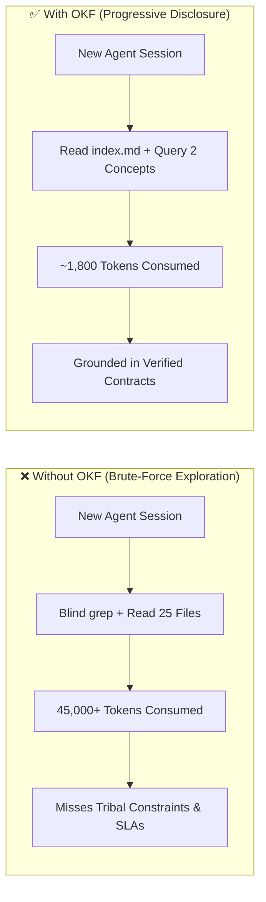

# Module 1: The Crisis of Codebase Amnesia & Why OKF Exists

**Level:** 🟢 Beginner | **Estimated Time:** 15 minutes  
**Next Module:** [Module 2: Anatomy of an OKF Concept & Guided Onboarding →](./02-concept-anatomy-and-wayfinder.md)

---

## 1. The Problem: Why Software Documentation Fails Both Humans and AI Agents

Every engineering team faces two compounding problems as a codebase grows:

### 1.1 The "Write-Once, Rot-Forever" Wiki Trap
Traditional documentation (Confluence pages, Notion docs, static `ARCHITECTURE.md` files) is **decoupled from the code edit lifecycle**.
- An engineer refactors an authentication flow or changes a retry policy in code.
- Nobody updates the wiki page written 14 months ago.
- Within weeks, developers and AI agents learn they **cannot trust the documentation**, reverting to reading raw source code from scratch every single time.

### 1.2 The AI Agent "Cold-Start" & Token Tax
Modern coding agents (Google Antigravity, Claude Code, Cursor, Codex) begin every new session with **complete codebase amnesia**. Without structured architectural memory:
1. The agent runs blind `grep` searches and reads 15–40 raw source files just to reconstruct a mental model of how components fit together.
2. **60% to 85% of the prompt context window** is consumed by exploratory noise before a single line of code is written.
3. Worse, raw code tells an agent *what* the code currently does, but rarely captures *why* (business constraints, SLAs, compliance rules, or upstream/downstream contracts).



---

## 2. What is the Open Knowledge Format (OKF)?

The **Open Knowledge Format (OKF)** is an open specification (currently **v0.2**) for storing, verifying, and exchanging curated architectural and domain knowledge right inside your repository (`/docs/okf` or `/okf`).

Instead of treating documentation as a static essay, OKF treats codebase knowledge as a **self-maintaining, machine-verifiable dependency graph** built on four non-negotiable engineering principles:

| Principle | What It Means in Practice | Why It Matters |
| :--- | :--- | :--- |
| **1. Readable** | Plain UTF-8 Markdown (`.md`) files with standard headings and prose. | Any developer can read or review it in GitHub, VS Code, or terminal without proprietary viewers. |
| **2. Parseable** | Structured YAML frontmatter (`---`) at the top of every concept file. | CLI scripts and LLM skills can deterministically extract types, resources, trust tiers, and expiration dates in milliseconds. |
| **3. Diffable** | Lives directly in Git alongside the source code it describes. | Architectural changes travel in the **exact same Pull Request** as the code change. |
| **4. Portable** | Zero vendor lock-in; works across Antigravity, Claude Code, Cursor, Codex, and CI pipelines. | Switch coding agents or IDEs without losing a single byte of project memory. |

---

## 3. Progressive Disclosure: How OKF Saves 80%+ of Context Tokens

Rather than dumping an entire documentation folder into an LLM's context window, an OKF bundle uses **two reserved files** at the bundle root (`/docs/okf/`) to enable progressive disclosure:

1. **`index.md` (The Catalog & Frontier Map):**
   - Lists every documented concept with a one-line summary (`- [Concept Title](/concepts/my-concept.md) — Brief description.`).
   - Tracks undocumented source files under `## Not yet specified` so humans and agents always know where the knowledge gaps ("the frontier") are.
   - Declares `okf_version: 0.2` in its YAML frontmatter.
2. **`log.md` (The Chronological Audit Trail):**
   - Records every bundle update under ISO 8601 date headings (`## YYYY-MM-DD`).
   - Gives both humans and agents an instant summary of recent architectural evolution without parsing `git log`.

When an agent starts a task, it doesn't read every file in the repo — it queries the bundle (`okf-query`) or scans `index.md` (~40 lines) and loads **only** the 1–3 concept files relevant to the task.

---

## 🧪 Hands-On Lab 1: Inspecting a Live OKF Bundle & Token Footprint

Run these commands from the root of the `okf-skills` repository to see progressive disclosure in action:

### Step 1: Inspect the Root Catalog (`docs/okf/index.md`)
```bash
node -e "console.log(require('fs').readFileSync('docs/okf/index.md', 'utf8'))"
```
Notice how `docs/okf/index.md` maps the entire repository's architecture in under 40 lines, separating **documented concepts** (`## Concepts and Skills`) from the **undocumented frontier** (`## Not yet specified`).

### Step 2: Query Targeted Context Instead of Reading Raw Source Files
```bash
node okf-query/scripts/query.js --search "lifecycle"
```
**What to observe:** Instead of reading 3,000+ lines of JavaScript across 8 skill directories, `okf-query` returns a compact `=== OKF CONTEXT BLOCK ===` containing the exact architectural overview, metadata, and trust tier in ~350 tokens.

---

## 🤖 Agent Tutor Prompt

Copy and paste this prompt into your AI coding agent (Antigravity, Claude Code, or Cursor) to practice Module 1 interactively:

> ```text
> Act as my OKF Academy Tutor for Module 1. Read docs/okf/index.md and docs/okf/log.md in this repository, then show me:
> 1) How many total concepts are currently indexed vs. listed under "Not yet specified",
> 2) How many approximate tokens it took to read index.md compared to reading all .js files in this repo, and
> 3) Ask me one scenario question to test my understanding of Progressive Disclosure.
> ```

---

## ✅ Knowledge Check

**Question 1:** Why do traditional engineering wikis fail coding agents during brownfield development?
- A) Coding agents cannot read Markdown syntax.
- B) Wikis are decoupled from the Git edit/commit lifecycle, causing silent documentation rot, and lack deterministic file-to-concept mappings. *(Correct)*
- C) Wikis only support SQL code blocks.

**Question 2:** Which four core principles define the Open Knowledge Format (OKF)?
- A) Readable, Parseable, Diffable, Portable *(Correct)*
- B) Encrypted, Proprietary, Cloud-Hosted, Binary
- C) Graph-Only, Stateful, Database-Backed, Agent-Exclusive

**Question 3:** What are the two reserved files at the root of an OKF bundle that do NOT represent individual domain concepts?
- A) `README.md` and `package.json`
- B) `schema.yaml` and `config.json`
- C) `index.md` and `log.md` *(Correct — `index.md` provides progressive disclosure & frontier tracking, while `log.md` records chronological changes under `## YYYY-MM-DD` headings.)*

---

👉 **[Continue to Module 2: Anatomy of an OKF Concept & Guided Onboarding →](./02-concept-anatomy-and-wayfinder.md)**
