# Module 2: Anatomy of an OKF Concept & Guided Onboarding (`okf` + `okf-wayfinder`)

**Level:** 🟢 Beginner → 🟡 Intermediate | **Estimated Time:** 20 minutes  
**Previous:** [← Module 1: Why OKF Exists](./01-why-okf-and-codebase-amnesia.md) | **Next:** [Module 3: What Changed in OKF v0.2 →](./03-okf-v02-trust-provenance-and-attestation.md)

---

## 1. Anatomy of an OKF Concept File

Every non-reserved `.md` file inside an OKF bundle (`index.md` and `log.md` are reserved) represents a **Concept**.

A Concept is a self-contained unit of knowledge — an architectural subsystem, an API contract, a domain model, an engineering playbook, or a sanctioned metric calculation.

### 1.1 The Minimum Valid Concept vs. Recommended Structure
Per the OKF Specification, the **only strictly required YAML frontmatter key** for a standard concept is a non-empty `type`:

```markdown
---
type: Architecture
---

# Payment Webhook Processor
Processes Stripe events idempotently...
```

However, production OKF bundles combine `type` with rich metadata so `okf-query`, `okf-lint`, `okf-maintain`, and `okf-prune` can automate retrieval, drift detection, and lifecycle hygiene:

```markdown
---
type: Architecture
title: Payment Webhook Processor
description: Handles incoming Stripe webhook events with Redis-backed idempotency locks.
resource: src/payments.js
tags: [payments, stripe, webhooks, idempotency]
status: stable
stale_after: 2027-06-01T00:00:00Z
generated:
  by: Antigravity/4.0
  at: 2026-10-21T12:00:00Z
verified:
  - by: human:payments-lead
    at: 2026-10-21T12:30:00Z
sources:
  - id: stripe-handler
    title: Stripe Webhook Controller
    path: src/payments.js
---

# Overview
The Payment Webhook Processor validates Stripe signatures and enforces idempotent execution[^stripe-handler].

# Related Concepts
- [Monthly Recurring Revenue (MRR)](/concepts/revenue-mrr-metric.md)

[^stripe-handler]: Implemented in `processStripeWebhook()` inside `src/payments.js`.
```

### 1.2 Building an Untyped Dependency Graph with Links
Notice the link syntax in `# Related Concepts`:
```markdown
- [Monthly Recurring Revenue (MRR)](/concepts/revenue-mrr-metric.md)
```
In OKF, internal links use **bundle-relative absolute paths** starting with `/`. Every link between two concept files forms a directed edge in your codebase's knowledge graph — without requiring complex RDF triples or graph database schemas!

---

## 2. Scaling Your Bundle: Flat vs. Nested Directory Layout

As a project grows, dumping 80 markdown files into a single folder makes `index.md` hard to scan. The `okf` and `okf-maintain` skills enforce an automatic **10-concept scaling threshold**:

```mermaid
flowchart LR
    subgraph Small["Flat Layout (< 10 Concepts)"]
        F1["/docs/okf/index.md"]
        F2["/docs/okf/log.md"]
        F3["/docs/okf/auth.md"]
        F4["/docs/okf/payments.md"]
    end

    subgraph Scaled["Categorized Layout (≥ 10 Concepts)"]
        S1["/docs/okf/index.md"]
        S2["/docs/okf/log.md"]
        S3["/docs/okf/concepts/auth.md"]
        S4["/docs/okf/concepts/payments.md"]
        S5["/docs/okf/metrics/mrr.md"]
    end

    Small -->|"Exceeds 10 Concepts\n(Auto-Refactored by okf-maintain)"| Scaled
```



* **Under 10 concepts:** A flat structure (`/docs/okf/*.md`) keeps small microservices simple.
* **10 or more concepts:** Concepts are organized into semantic subdirectories (e.g., `/concepts/`, `/architecture/`, `/metrics/`, `/playbooks/`), and `okf-maintain` automatically rewrites internal `/...` links so nothing breaks.

---

## 3. Overcoming "Blank Page Syndrome" with `okf-wayfinder`

The hardest part of adopting documentation in a legacy ("brownfield") codebase is knowing **where to start** and **what tribal knowledge to write down**.

The **`okf-wayfinder`** skill solves this in two steps:

### Step 1: Automated Frontier & Taxonomy Scanning (`wayfinder_taxonomy.js`)
Running `node okf-wayfinder/scripts/wayfinder_taxonomy.js` scans your workspace and outputs a JSON map of:
1. **`existing_types` & `existing_tags`:** The vocabulary already used in your bundle so new concepts stay consistent (no mixing `auth`, `authentication`, and `AuthN` randomly).
2. **`documented_resources`:** Which source files are already covered by an OKF concept.
3. **`frontier` (`## Not yet specified` in `index.md`):** Undocumented source files in the repository that still need concept coverage. When `okf-maintain` runs, it syncs these files into the `## Not yet specified` section of `index.md` so any engineer or agent opening the bundle index immediately sees the frontier.

### Step 2: Context-Aware Developer Interviews
Instead of asking a developer *"Please write documentation for `src/invoice-tax-engine.js`"*, an agent running `okf-wayfinder` reads the code first, infers what it can, and interviews the developer with 2–3 targeted questions about **what isn't obvious from the code**:
* *"I see `calculateRegionalTax` hardcodes rates for `US_CA`, `EU_DE`, and `UK`. Why are these hardcoded instead of calling a tax API, and what happens if a customer is in another region?"*
*Once the developer answers in plain chat, `okf-wayfinder` generates the complete, lint-compliant OKF concept file and updates `index.md` and `log.md`.*

---

## 🧪 Hands-On Lab 2: Discovering the Undocumented Frontier in the Sandbox

Let's run the Wayfinder taxonomy scanner against our practice sandbox (`docs/course/sandbox`) to see how it discovers undocumented code automatically!

### Step 1: Run `wayfinder_taxonomy.js` in the Sandbox Workspace
```bash
node -e "const { execSync } = require('child_process'); console.log(execSync('node ../../../okf-wayfinder/scripts/wayfinder_taxonomy.js', { cwd: 'docs/course/sandbox' }).toString());"
```

### Expected Output:
```json
{
  "bundle_root": ".../docs/course/sandbox/okf",
  "existing_types": [
    "Architecture",
    "Attested Computation",
    "Concept"
  ],
  "existing_tags": [
    "auth", "billing", "finance", "legacy", "metrics", "mrr", "oauth1", "payments", "security", "v0.1", "v0.2", "webhooks"
  ],
  "documented_resources": [
    "src/payments.js"
  ],
  "frontier": [
    {
      "path": "src/invoice-tax-engine.js",
      "suggested_description": "Undocumented codebase file."
    }
  ]
}
```
**What just happened?**
- Wayfinder saw that `src/payments.js` is already documented by `legacy-payment-service.md`.
- It immediately flagged `src/invoice-tax-engine.js` in the **`frontier`** array as needing documentation, while providing the exact `existing_types` and `existing_tags` taxonomy to use!

---

## 🤖 Agent Tutor Prompt

Copy and paste this prompt into your AI coding agent to experience an interactive Wayfinder interview:

> ```text
> Act as my OKF Wayfinder interviewer for Module 2. Inspect docs/course/sandbox/src/invoice-tax-engine.js and the taxonomy output from wayfinder_taxonomy.js in docs/course/sandbox. Ask me 2 brief interview questions about the business rules and compliance constraints of calculateRegionalTax(), and then show me the complete OKF v0.2 concept markdown you would generate from my answers (without saving it to disk).
> ```

---

## ✅ Knowledge Check

**Question 1:** What is the ONLY strictly required YAML frontmatter property for a standard OKF concept file?
- A) `author`
- B) `type` *(Correct — every non-reserved `.md` file in an OKF bundle must declare a non-empty `type` in its YAML frontmatter.)*
- C) `runtime`

**Question 2:** How should internal links between concepts inside an OKF bundle be formatted?
- A) Full `https://github.com/...` URLs
- B) Bundle-relative absolute paths starting with `/` (e.g., `[Legacy Payment Service](/concepts/legacy-payment-service.md)`) *(Correct)*
- C) Windows backslash paths (`\concepts\file.md`)

**Question 3:** What does `wayfinder_taxonomy.js` report in its `frontier` array?
- A) Workspace source files that are not yet linked as a `resource` in any OKF concept. *(Correct)*
- B) Concepts that have syntax errors in their YAML frontmatter.
- C) Git branches that have not been merged into `main`.

---

👉 **[Continue to Module 3: What Changed in OKF v0.2 & The Problems It Solves →](./03-okf-v02-trust-provenance-and-attestation.md)**
