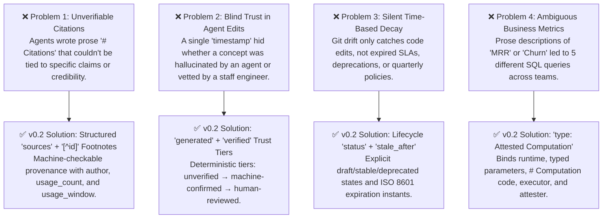

# Module 3: What Changed in OKF v0.2 & The Problems It Solves

**Level:** 🟡 Intermediate *(Core Focus Module)* | **Estimated Time:** 30 minutes  
**Previous:** [← Module 2: Concept Anatomy & Wayfinder](./02-concept-anatomy-and-wayfinder.md) | **Next:** [Module 4: Steering Gates & Context Injection →](./04-steering-gates-and-context-injection.md)

---

## 1. Why OKF v0.1 Wasn't Enough for Production Agentic Engineering

OKF v0.1 proved that colocating Markdown concepts with a codebase (`type`, `resource`, `timestamp`, and `# Citations`) drastically reduced agent cold-start times.

However, as teams deployed autonomous agents at scale, **four critical failure modes emerged in v0.1**:



Let's examine each of these four v0.2 breakthroughs in detail.

---

## 2. Breakthrough 1: Structured Provenance (`sources` & `[^id]` Footnotes)

### The v0.1 Problem
In v0.1, authors placed a free-form `# Citations` bullet list at the bottom of a file:
```markdown
# Citations
- Stripe Webhook Doc: https://docs.acme.internal/webhooks
```
*Why this failed:* If a 500-word concept contained 12 architectural claims and 3 citations at the bottom, neither a human reviewer nor `okf-lint` knew **which claim came from which source**, or how trustworthy that source was.

### The v0.2 Solution
OKF v0.2 moves provenance into a structured **`sources`** list in YAML frontmatter and binds individual sentences in the Markdown body to specific sources using **standard Markdown footnotes (`[^id]`)**:

```yaml
sources:
  - id: asc606-policy
    title: Enterprise Revenue Recognition Policy (ASC 606)
    url: https://docs.acme.internal/finance/asc-606-mrr
    usage_window: 90d
    credibility:
      author: human:vp-finance
      usage_count: 142
      last_modified: 2026-09-01T00:00:00Z
  - id: billing-schema
    title: Subscriptions Table DDL
    path: db/migrations/004_subscriptions.sql
```
And in the body:
```markdown
Calculates Net MRR across all `active` and `past_due` subscriptions[^asc606-policy], normalizing annual plans by dividing `amount_cents` by 12[^billing-schema].

[^asc606-policy]: Excludes one-time setup fees per ASC 606 guidelines.
[^billing-schema]: Uses `subscriptions.billing_interval` and `subscriptions.amount_cents`.
```
* **What this solves:** `okf-lint` now statically verifies that every `[^id]` footnote resolves to a declared source, and agents ingesting the concept can weigh claims backed by high-credibility sources (`usage_count: 142`, `author: human:vp-finance`) over unverified folklore.

---

## 3. Breakthrough 2: Actor Identity & The 3-Tier Trust Model (`generated` & `verified`)

### The v0.1 Problem
OKF v0.1 used a single scalar `timestamp: 2025-11-15T10:30:00Z`.
*Why this failed:* When an autonomous coding agent updated a concept during a commit, there was **zero distinction** between a freshly hallucinated agent draft and a security architecture spec signed off by your Principal Security Engineer.

### The v0.2 Solution: `generated`, `verified`, and Actor URIs
OKF v0.2 replaces `timestamp` with two structured blocks using standardized **Actor Identifiers**:
* **AI Agents / Tools:** `<producer>/<version>` (e.g., `Antigravity/4.0`, `claude-code/1.2.0`, `okf-maintain/1.6.0`) — *Note: v0.2 drops the legacy `agent:` prefix!*
* **Humans:** `human:<id>` (e.g., `human:alice`, `human:finance-lead`)
* **Automated Processes:** `process:<id>` (e.g., `process:nightly-ci`)

```yaml
generated:
  by: Antigravity/4.0
  at: 2026-10-15T09:00:00Z
verified:
  - by: okf-lint/1.6.0
    at: 2026-10-15T09:05:00Z
  - by: human:finance-lead
    at: 2026-10-16T14:20:00Z
```

### How OKF v0.2 Computes Trust Tiers Deterministically
Every concept automatically resolves to one of three **Trust Tiers** (displayed in `okf-query` and `okf-visualize`):

| Trust Tier | How It Is Earned | Timestamp Freshness Rule (`verified.at >= generated.at`) |
| :--- | :--- | :--- |
| ⚪ **`unverified`** | Has `generated` (or no `verified` block), or all `verified` entries are older than `generated.at`. | Default state whenever an agent generates or edits a concept. |
| 🔵 **`machine-confirmed`** | Has at least one `verified` entry by an independent machine/linter actor (`<producer>/<version>` or `process:<id>`) where `verified.at >= generated.at`. | Proves a second automated check validated the concept after its last edit. |
| 🟢 **`human-reviewed`** | Has at least one `verified` entry by a `human:<id>` actor where `verified.at >= generated.at`. | Highest trust tier — proves a human domain expert reviewed the current revision. |

> [!IMPORTANT]
> **Automatic Trust Downgrade on Re-Generation:** If a concept is `human-reviewed` (`verified.at: Oct 16`), and an AI agent modifies and regenerates the concept on `Oct 20` (`generated.at: Oct 20`), `okf-lint` flags that the verification timestamp precedes `generated.at`. You can never accidentally carry a stale human sign-off onto newly modified agent prose!

---

## 4. Breakthrough 3: Lifecycle States & Time-Bounded Freshness (`status` & `stale_after`)

### The v0.1 Problem
In v0.1, drift detection only compared Git commit dates of a code file against the concept's timestamp.
*Why this failed:* What if a concept describes an external vendor SLA, an OAuth1 deprecation timeline, or a compliance audit that expires on January 1st — **even if no code file in the repository was touched**?

### The v0.2 Solution
OKF v0.2 adds two lifecycle properties:
1. **`status`**: `draft` | `stable` *(default)* | `deprecated`
   - Marking a concept `status: deprecated` signals to coding agents via `okf-query` that they must **not** build new features on top of that pattern.
2. **`stale_after`**: An ISO 8601 UTC instant (e.g., `stale_after: 2027-01-01T00:00:00Z`).
   - Once the wall-clock time passes `stale_after`, `okf-lint` emits a staleness warning and `okf-prune` flags the concept for re-verification or archiving — even if zero lines of code changed!

---

## 5. Breakthrough 4: `type: Attested Computation`

### The v0.1 Problem
In data engineering and backend systems, critical metrics like **Net MRR**, **Daily Active Users**, or **P99 Latency SLA** were documented in prose. When an agent was asked to build a billing dashboard, it guessed the SQL query from prose — often forgetting edge cases like 14-day grace periods or annual plan normalization.

### The v0.2 Solution
OKF v0.2 introduces **`type: Attested Computation`** — a specialized concept contract that binds the prose definition, the exact parameterized code/SQL, the execution script, and the deterministic verification script into a single artifact:

```yaml
type: Attested Computation
title: Monthly Recurring Revenue (MRR)
runtime: postgres
parameters:
  - name: as_of_date
    type: date
    default: "2026-10-01"
    description: UTC snapshot date for active subscription evaluation
executor: scripts/run-mrr-report.sh
attester: scripts/verify-mrr-reconciliation.py
```
Combined with a `# Computation` code block in the Markdown body, agents no longer guess how to calculate business metrics — they retrieve the exact sanctioned query and parameter contract via `okf-query`.

---

## 6. Automated Migration from v0.1 to v0.2 (`okf-upgrade`)

You don't need to migrate legacy v0.1 bundles by hand. Running **`okf-upgrade`** (`node okf-upgrade/scripts/upgrade.js`) automatically:
1. Adds `okf_version: 0.2` to the root `index.md`.
2. Converts legacy `timestamp: <iso>` fields into `generated: { by: okf-upgrade/0.2, at: <iso> }`.
3. Strips legacy `agent:` prefixes from actor strings (`agent:claude` → `claude`).
4. Parses inline `# Citations` sections, converts them into structured frontmatter `sources`, and injects `[^src-N]` footnotes.
5. Normalizes `log.md` date headings to strict `## YYYY-MM-DD` format.

---

## 🧪 Hands-On Lab 3: Inspecting v0.1 vs. v0.2 & Testing Trust Tiers in the Sandbox

Let's inspect the sandbox fixtures in `docs/course/sandbox/okf/` to see all four v0.2 features in action!

### Step 1: Query the `Attested Computation` in the Sandbox
```bash
node -e "const { execSync } = require('child_process'); console.log(execSync('node ../../../okf-query/scripts/query.js --search MRR', { cwd: 'docs/course/sandbox' }).toString());"
```
**Observe the output:**
- `Type: Attested Computation`
- `Status: stable`
- `Stale After: 2027-12-31T23:59:59Z`
- `Trust Tier: human-reviewed` (because `verified` includes `by: human:finance-lead` with a timestamp newer than `generated.at`!)
- Full `# Computation` SQL block and `[^asc606-policy]` footnotes ready for agent ingestion.

### Step 2: Run `okf-lint` on the Sandbox to Catch the Expired Concept
```bash
node -e "const { spawnSync } = require('child_process'); const r = spawnSync('node', ['../../../okf-lint/scripts/lint.js'], { cwd: 'docs/course/sandbox', encoding: 'utf8' }); console.log(r.stdout);"
```
**Observe the output:**
`[concepts/expired-auth-flow.md] Warning: Concept is stale (stale_after: 2025-01-01T00:00:00Z has passed). Please re-verify and update stale_after.`

---

## 🤖 Agent Tutor Prompt

Copy and paste this prompt into your AI coding agent to practice migrating v0.1 to v0.2:

> ```text
> Act as my OKF Academy Tutor for Module 3. Read docs/course/sandbox/okf/concepts/legacy-payment-service.md (which is in OKF v0.1 format) and docs/course/sandbox/okf/concepts/revenue-mrr-metric.md (which is in OKF v0.2 format). Show me a side-by-side comparison of how legacy-payment-service.md looks before and after upgrading to OKF v0.2 (including generated, verified, status, stale_after, and sources with footnotes), without modifying the file on disk.
> ```

---

## ✅ Knowledge Check

**Question 1:** A concept has `generated: { by: Antigravity/4.0, at: 2026-10-20T10:00:00Z }` and `verified: [{ by: okf-lint/1.6.0, at: 2026-10-20T10:05:00Z }]`. What is its OKF v0.2 Trust Tier?
- A) `unverified`
- B) `machine-confirmed` *(Correct — it has a valid verification entry after `generated.at` by a machine/tool actor, but no `human:<id>` entry yet.)*
- C) `human-reviewed`

**Question 2:** What happens if a `human-reviewed` concept (verified on Oct 10) is edited and regenerated by an AI agent on Oct 21 (`generated.at: 2026-10-21`), without a new verification entry?
- A) It permanently stays `human-reviewed` forever.
- B) `okf-lint` warns that the verification timestamp precedes `generated.at`, preventing stale human sign-offs from masking unreviewed agent edits. *(Correct)*
- C) The file is deleted by Git.

**Question 3:** Which OKF v0.2 concept `type` binds a `runtime`, typed `parameters`, `# Computation` code block, `executor`, and `attester`?
- A) `type: SQL`
- B) `type: Attested Computation` *(Correct)*
- C) `type: Metric-V1`

**Question 4:** Why did OKF v0.2 introduce `stale_after` alongside Git-based drift detection?
- A) To replace Git completely.
- B) Because external truths (vendor SLAs, compliance policies, deprecation deadlines) can expire over time even when zero lines of repository code change. *(Correct)*
- C) To slow down `okf-query`.

---

👉 **[Continue to Module 4: Closing the Loop — Steering Gates & Context Injection →](./04-steering-gates-and-context-injection.md)**
