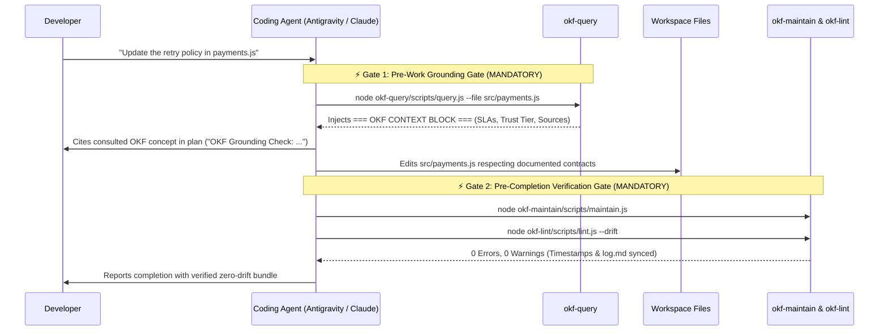

# Module 4: Closing the Loop — Steering Gates & Context Injection (`AGENTS.md` + `okf-query`)

**Level:** 🟡 Intermediate | **Estimated Time:** 20 minutes  
**Previous:** [← Module 3: What Changed in OKF v0.2](./03-okf-v02-trust-provenance-and-attestation.md) | **Next:** [Module 5: Autonomous Upkeep, Drift & Visualization →](./05-autonomous-upkeep-drift-and-visualization.md)

---

## 1. The Missing Link: Why Good Documentation Still Gets Ignored by AI Agents

Even if you author a pristine OKF v0.2 bundle with `sources`, `verified` trust tiers, and `Attested Computation` contracts, a critical failure mode remains:
- **By default, coding agents jump straight to `grep` and file editing** without checking `/docs/okf` first.
- Worse, after modifying code, agents finish their turn and declare success **without updating the documentation they just invalidated**.

To make a repository truly self-documenting, we must bind the OKF bundle into the agent's **system-level execution loop** using **Agent Steering Files** (`AGENTS.md`, `CLAUDE.md`, `.cursorrules`, `.windsurfrules`, `.clinerules`, `GEMINI.md`) and **`okf-query`**.

---

## 2. The Two Mandatory Agent Steering Gates (`okf-steering-version: 1.6.0`)

In OKF Skills v1.6.0, root steering files enforce two hard gates around every agent turn:



### Gate 1: The Pre-Work Grounding Gate
Before inspecting code, planning architecture, answering system questions, or modifying files, the agent **MUST**:
1. **Initial Search & Discovery:** Run `node okf-query/scripts/query.js --search <keywords>` or inspect `/docs/okf/index.md` to ground domain understanding.
2. **Target File Retrieval:** Before modifying or analyzing any specific file, run `node okf-query/scripts/query.js --file <file-path>` to inject design contracts, SLAs, and dependencies into its context window.
3. **Grounding Citation:** Explicitly cite the consulted OKF concept(s) (or state *"OKF Check: no matching concept found for \<topic\>"*) in its response before modifying code.

### Gate 2: The Pre-Completion Verification Gate
Before claiming any user request is complete after modifying workspace code, the agent **MUST**:
1. Run `node okf-maintain/scripts/maintain.js` to sync concept timestamps, unindexed frontier files, `log.md`, and `viz.html`.
2. Run `node okf-lint/scripts/lint.js --drift` to guarantee **0 errors and 0 warnings**.

> [!TIP]
> **Self-Healing Steering Files:** If `AGENTS.md` or `CLAUDE.md` is missing the `<!-- okf-steering-version: 1.6.0 -->` marker or either mandatory gate, `okf-lint` flags a warning and `okf-maintain` automatically heals the steering file to the latest template!

---

## 3. How `okf-query` Retrieves Context Deterministically

Unlike vector-database RAG (which requires embedding API keys, external servers, and often retrieves fragmented chunks), **`okf-query`** (`okf-query/scripts/query.js`) uses deterministic, zero-dependency structural matching across two modes:

### Mode A: File-to-Concept Resolution (`--file <path>`)
When an agent is about to edit `src/payments.js` and runs `okf-query --file src/payments.js`, the script executes a **2-tier resolution cascade**:
1. **Tier 1 (Direct & Enclosing Match):** Checks every concept's `resource` (and `sources[].resource` / `sources[].path`) to see if it matches `src/payments.js` or an enclosing parent directory.
2. **Tier 2 (Subsystem / Sibling Match):** If `src/payments_helper.js` isn't directly listed, `okf-query` checks if any concept documents another file in the same `src/` subsystem directory and injects that subsystem's architectural concept automatically!

### Mode B: Keyword & Tag Search (`--search <query>`)
Scans every concept's `title`, `description`, `type`, `tags`, and Markdown body case-insensitively, outputting a structured **`=== OKF CONTEXT BLOCK ===`** complete with the computed **OKF v0.2 Trust Tier** (`unverified`, `machine-confirmed`, or `human-reviewed`) and `stale_after` status.

---

## 🧪 Hands-On Lab 4: Running Context Retrieval in the Sandbox

Let's test both `okf-query` modes against our practice sandbox (`docs/course/sandbox`):

### Step 1: Retrieve Context by Target File (`--file`)
```bash
node -e "const { execSync } = require('child_process'); console.log(execSync('node ../../../okf-query/scripts/query.js --file src/payments.js', { cwd: 'docs/course/sandbox' }).toString());"
```
**What to observe:** `okf-query` matches `resource: src/payments.js` in `legacy-payment-service.md` and outputs the retry policy (5 retries with exponential backoff to DLQ) before you ever open `src/payments.js`.

### Step 2: Test Tier-2 Subsystem Fallback on an Undocumented Sibling File
What happens if an agent queries `--file src/invoice-tax-engine.js`, which doesn't have its own concept yet?
```bash
node -e "const { execSync } = require('child_process'); console.log(execSync('node ../../../okf-query/scripts/query.js --file src/invoice-tax-engine.js', { cwd: 'docs/course/sandbox' }).toString());"
```
**What to observe:** Because `src/invoice-tax-engine.js` lives in the same `src/` subsystem directory as `src/payments.js`, `okf-query`'s **Tier 2 Subsystem Match** automatically injects the neighboring `src/` architecture context instead of returning empty-handed!

---

## 🤖 Agent Tutor Prompt

Copy and paste this prompt into your AI coding agent to see how the Pre-Work Grounding Gate operates in real time:

> ```text
> Act as my OKF Academy Tutor for Module 4. Show me the exact Pre-Work Grounding Gate sequence you follow when I ask you to inspect okf-query/scripts/query.js in this repository: run okf-query --file okf-query/scripts/query.js, show me your Grounding Citation, and explain how Tier 1 vs. Tier 2 file matching works in query.js.
> ```

---

## ✅ Knowledge Check

**Question 1:** What are the three required actions in the `AGENTS.md` **Pre-Work Grounding Gate** before modifying code?
- A) Initial Search (`--search` or `index.md`), Target File Retrieval (`--file`), and an explicit Grounding Citation in the agent's response. *(Correct)*
- B) Deleting `node_modules`, running `git push --force`, and restarting the IDE.
- C) Writing a Confluence page, emailing the team lead, and waiting 24 hours.

**Question 2:** How does `okf-query --file <path>` behave if the exact file path isn't directly listed in any concept's `resource`, but another file in the same subsystem folder is documented?
- A) It crashes with a fatal error.
- B) Tier 2 Subsystem Matching retrieves the concept documenting the enclosing directory/subsystem so the agent still receives relevant module constraints. *(Correct)*
- C) It deletes the undocumented file.

**Question 3:** Which comment tag at the bottom of `AGENTS.md` allows `okf-lint` and `okf-maintain` to verify that the steering rules are up to date?
- A) `<!-- okf-steering-version: 1.6.0 -->` *(Correct)*
- B) `<!-- do-not-edit -->`
- C) `# version: 0.1`

---

👉 **[Continue to Module 5: Autonomous Upkeep, Drift Detection & Graph Visualization →](./05-autonomous-upkeep-drift-and-visualization.md)**
