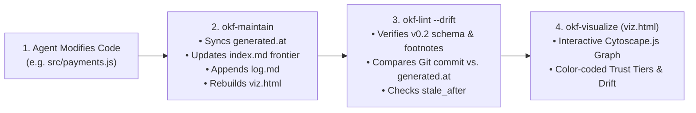

# Module 5: Autonomous Upkeep, Drift Detection & Graph Visualization (`okf-maintain`, `okf-lint`, `okf-visualize`)

**Level:** 🔵 Advanced | **Estimated Time:** 25 minutes  
**Previous:** [← Module 4: Steering Gates & Context Injection](./04-steering-gates-and-context-injection.md) | **Next:** [Module 6: Knowledge Hygiene & CI Gates →](./06-pruning-hygiene-and-ci-gates.md)

---

## 1. How OKF Eliminates Documentation Rot Automatically

In Modules 1–4, we saw how concepts are structured and queried. Now we tackle the hardest engineering problem in knowledge management: **Keeping documentation synchronized as code evolves at high velocity.**

OKF solves this through three tightly integrated skills that form the **Pre-Completion Verification Gate**:
1. **`okf-maintain`** — The automated upkeep engine that synchronizes timestamps, frontier files, changelogs, and steering templates post-edit.
2. **`okf-lint`** — The static and Git-history verifier that blocks broken links, schema violations, stale concepts, and code-documentation drift.
3. **`okf-visualize`** — The interactive Cytoscape.js knowledge graph generator (`viz.html`) for human-in-the-loop (HITL) architectural auditing.



---

## 2. Inside `okf-maintain`: Mechanical Upkeep Without Manual Toil

When an engineer or coding agent finishes editing files and runs `node okf-maintain/scripts/maintain.js` (or `npm run okf:maintain`), the script performs **six automated maintenance passes**:

1. **Git Concept-Resource Drift Detection & Timestamp Sync:**
   - For every concept with a `resource` path, `maintain.js` queries `git log -1 --format=%aI -- <resource>` to find the exact timestamp of the latest code commit.
   - If the code file is newer than the concept's `generated.at` (or if the file has uncommitted git modifications), `maintain.js` refreshes `generated.at` to the current UTC ISO timestamp after the concept is reviewed/updated.
2. **Agent Steering Auto-Healing:**
   - Scans `AGENTS.md`, `CLAUDE.md`, `.cursorrules`, `.windsurfrules`, `.clinerules`, and `GEMINI.md`. If any file has an outdated `okf-steering-version` or is missing the Pre-Work / Pre-Completion Gates, it automatically upgrades the steering block in place.
3. **Workspace Frontier Synchronization (`## Not yet specified`):**
   - Walks the workspace (respecting `.gitignore` and ignoring `docs/`, `node_modules/`, `.git/`) to find any new code files that are not yet linked as a `resource` in any concept, and lists them under `## Not yet specified` in `index.md`.
4. **Scale Transition & Link Refactoring:**
   - When a flat bundle crosses **10 concepts**, `okf-maintain` organizes concepts into categorized subdirectories and rewrites internal Markdown links automatically.
5. **Chronological Changelog (`log.md`) Append:**
   - Appends a dated entry under `## YYYY-MM-DD` in `log.md` summarizing which concepts were synchronized or added.
6. **Visualizer Rebuild (`viz.html`) & Final Lint Check:**
   - Invokes `okf-visualize` to regenerate `viz.html` and runs `okf-lint` to confirm zero errors.

> [!NOTE]
> **Audit-Only Mode (`--check`):** In CI or pre-commit hooks, running `node okf-maintain/scripts/maintain.js --check` performs a non-destructive check and exits with code `1` if any drift, unindexed frontier files, or outdated steering notices are detected.

---

## 3. Inside `okf-lint`: Static Conformance & Git Drift Analysis

`okf-lint` (`node okf-lint/scripts/lint.js`) acts as the compiler for your knowledge bundle. Here is everything it verifies:

| Verification Pass | What It Checks | Flag / Mode |
| :--- | :--- | :--- |
| **1. Frontmatter Conformance** | Every non-reserved `.md` file has valid YAML frontmatter with a non-empty `type`. | Always active |
| **2. OKF v0.2 Actor & Provenance Rules** | Warns on legacy `agent:` prefixes in `generated.by`/`verified.by`; checks that `verified[].at >= generated.at`; validates `[^id]` footnotes against `sources`; checks `Attested Computation` required keys (`runtime`, `# Computation`). | Always active |
| **3. Internal Link Integrity** | Strips fenced code blocks and inline code ticks, then verifies that every internal Markdown link (`/concepts/...`) resolves to an existing file on disk. | Always active (`--strict-links` checks external resource files too) |
| **4. Time-Based Freshness (`stale_after`)** | Compares `stale_after` against `new Date()` and warns if a concept has expired. | Always active |
| **5. Git-Based Concept Drift (`--drift`)** | Compares `git log -1 --format=%aI` of each concept's `resource` file against `generated.at`. Warns if the code was committed *after* the documentation was last updated! | `--drift` (`npm run okf:lint:drift`) |

---

## 4. Human-in-the-Loop Auditing with `okf-visualize` (`viz.html`)

While `okf-query` is optimized for LLM context windows, humans understand complex architectures best **visually**.

Running `node okf-visualize/scripts/visualize.js --bundle docs/okf` (or `npm run okf:viz`) generates a self-contained, interactive **Cytoscape.js HTML graph (`docs/okf/viz.html`)**:
- **Nodes** represent Concepts (sized by connectivity and styled by `type` and `status`).
- **Directed Edges** represent cross-concept Markdown links (`/concepts/...`).
- **Interactive Sidebar Inspector:** Clicking any node opens its full rendered Markdown, frontmatter metadata, resource path, and **OKF v0.2 Trust Tier badge** (`unverified`, `machine-confirmed`, `human-reviewed`) with search and tag filtering.

---

## 🧪 Hands-On Lab 5: Auditing Drift, Maintenance & Graph Visualization

Run these commands from the repository root to experience the verification and visualization pipeline:

### Step 1: Run `okf-lint --drift --json` on the Main Repository Bundle
```bash
node okf-lint/scripts/lint.js --drift --json
```
**What to observe:** Inspect the machine-readable JSON summary (`filesChecked`, `errors`, `warnings`, `driftCount`, `staleCount`).

### Step 2: Generate an Interactive Knowledge Graph for the Practice Sandbox
```bash
node okf-visualize/scripts/visualize.js --bundle docs/course/sandbox/okf
```
Then check that `docs/course/sandbox/okf/viz.html` was generated (and clean it up afterward so the sandbox stays pristine):
```bash
node -e "const fs = require('fs'); console.log('Sandbox viz.html generated:', fs.existsSync('docs/course/sandbox/okf/viz.html')); fs.unlinkSync('docs/course/sandbox/okf/viz.html');"
```

---

## 🤖 Agent Tutor Prompt

Copy and paste this prompt into your AI coding agent to practice debugging concept drift:

> ```text
> Act as my OKF Academy Tutor for Module 5. Explain the exact difference between how okf-lint detects Git-based Concept Drift (--drift) versus Time-Based Staleness (stale_after). Then run node okf-maintain/scripts/maintain.js --check --json on this repository and explain each field in the JSON output to me.
> ```

---

## ✅ Knowledge Check

**Question 1:** How does `okf-lint --drift` detect that a concept has drifted out of sync with the codebase?
- A) It compares the Git last-modified commit timestamp (`git log -1 --format=%aI`) of the concept's `resource` file against the concept's `generated.at` (or `timestamp`) field. *(Correct)*
- B) It counts the number of lines in the file.
- C) It checks whether the file is written in TypeScript or Python.

**Question 2:** Which flag allows you to run `okf-maintain` in a read-only CI check mode that exits with code `1` if drift or unindexed frontier files are found, without modifying any files?
- A) `--delete`
- B) `--check` *(Correct — `node okf-maintain/scripts/maintain.js --check` performs a non-destructive audit.)*
- C) `--force`

**Question 3:** Why does `okf-lint` strip fenced code blocks (` ``` `) and inline code ticks (`` ` ``) before checking Markdown link integrity?
- A) To make the file smaller.
- B) So illustrative link examples inside code blocks (like `` `[Example](/concepts/hypothetical.md)` ``) don't trigger false-positive broken link errors. *(Correct)*
- C) Because YAML does not allow code blocks.

---

👉 **[Continue to Module 6: Knowledge Hygiene at Scale — Pruning & CI Quality Gates →](./06-pruning-hygiene-and-ci-gates.md)**
