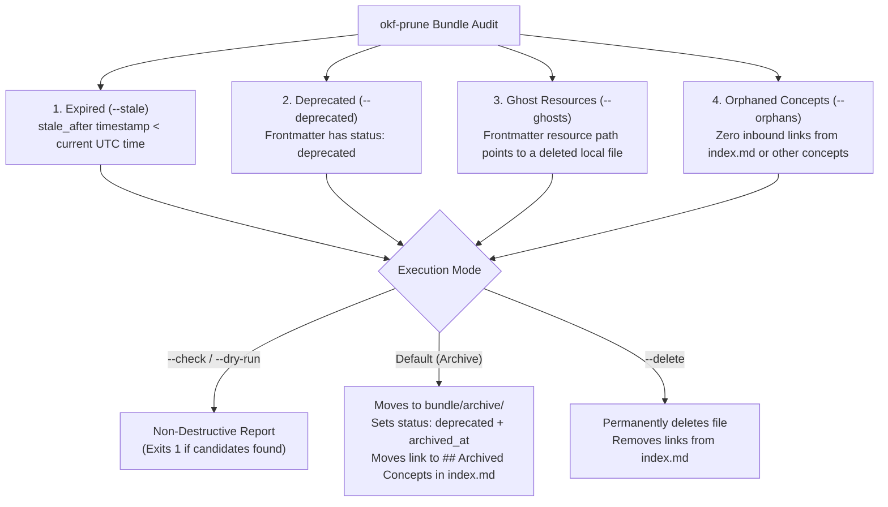

# Module 6: Knowledge Hygiene at Scale — Pruning, Garbage Collection & CI Gates (`okf-prune` + GitHub Actions)

**Level:** 🔵 Advanced → 🟣 Architect | **Estimated Time:** 20 minutes  
**Previous:** [← Module 5: Autonomous Upkeep, Drift & Visualization](./05-autonomous-upkeep-drift-and-visualization.md) | **Next:** [Module 7: Architect Capstone →](./07-capstone-self-documenting-repo.md)

---

## 1. The Long-Term Scaling Problem: Knowledge Accumulation & Dead Weight

In the first few months of using OKF, your focus is on **creating** concepts (`okf`, `okf-wayfinder`) and **updating** them (`okf-maintain`).

But what happens 18 months later across a 200-engineer organization?
- Microservices and legacy files get deleted during refactors, leaving behind concepts whose `resource` points to a non-existent file.
- Temporary migration playbooks pass their `stale_after` expiration date.
- Deprecated APIs (`status: deprecated`) clutter `okf-query` search results, confusing coding agents with obsolete patterns.
- Disconnected concepts become **orphans** that aren't linked from `index.md` or any other concept.

Without automated garbage collection, an agent's context window gradually fills up with dead weight. That is why the 10th step of the Knowledge Loop is **`okf-prune`**.

---

## 2. The 4 Categories of Knowledge Decay Detected by `okf-prune`

Running `node okf-prune/scripts/prune.js` scans your bundle and classifies pruning candidates across four dimensions:



### Safe Archiving (Default) vs. Permanent Deletion (`--delete`)
By default, `okf-prune` is **non-destructive to historical context**:
1. **Archive Mode (Default):**
   - Moves the concept from `concepts/foo.md` to `archive/concepts/foo.md`.
   - Injects `status: deprecated` and `archived_at: <ISO-timestamp>` into its frontmatter.
   - Relocates its entry in `index.md` under an `## Archived Concepts` section.
   - Appends a record to `log.md` and regenerates `viz.html`.
   - *Why this matters:* `okf-query` ignores `archive/` during active agent retrieval so agents aren't polluted by obsolete patterns, while humans still retain full historical provenance in Git!
2. **Permanent Deletion Mode (`--delete`):**
   - Permanently unlinks the file from disk and removes its entry from `index.md`.
3. **Selective Category Flags:**
   - You can target specific decay types using `--stale`, `--deprecated`, `--ghosts`, or `--orphans`.

---

## 3. Enforcing the Knowledge Loop in CI/CD (`.github/workflows/okf-test.yml`)

Steering files (`AGENTS.md`) guide well-behaved coding agents locally, but **CI quality gates guarantee compliance across every Pull Request** — whether authored by a human, Antigravity, Claude Code, or a third-party bot.

In this repository, [`.github/workflows/okf-test.yml`](../../.github/workflows/okf-test.yml) runs on every push and PR to `main`:

```yaml
name: OKF Bundle Verification & Lifecycle Tests

on:
  push:
    branches: [ main ]
  pull_request:
    branches: [ main ]

jobs:
  verify-okf:
    runs-on: ubuntu-latest
    steps:
      - uses: actions/checkout@v4
        with:
          fetch-depth: 0 # Required so okf-lint --drift can inspect git log timestamps!

      - uses: actions/setup-node@v4
        with:
          node-version: '20'

      - name: Run Unit & Lifecycle Integration Tests
        run: npm test

      - name: Run OKF Drift & Conformance Gate
        run: npm run okf:lint:drift
```

> [!WARNING]
> **Critical CI Pitfall (`fetch-depth: 0`):** Always set `fetch-depth: 0` in `actions/checkout@v4` when running `okf-lint --drift` or `okf-maintain --check` in GitHub Actions! With a shallow clone (`fetch-depth: 1`), every file in the repository appears to have been committed at the exact timestamp of the latest commit, masking historical concept-resource drift.

---

## 🧪 Hands-On Lab 6: Auditing Expired Concepts with `okf-prune --dry-run`

Let's run `okf-prune` in `--dry-run` mode against our practice sandbox (`docs/course/sandbox`) to see how it detects `expired-auth-flow.md` without mutating the working tree!

### Step 1: Run a Human-Readable Prune Audit (`--dry-run`)
```bash
node -e "const { spawnSync } = require('child_process'); const r = spawnSync('node', ['../../../okf-prune/scripts/prune.js', '--dry-run'], { cwd: 'docs/course/sandbox', encoding: 'utf8' }); console.log(r.stdout);"
```
### Expected Output:
```text
=== OKF Prune Audit (1 candidate(s) found) ===

- [Expired OAuth1 Flow] (concepts/expired-auth-flow.md)
    ↳ Reason: Expired (stale_after: 2025-01-01T00:00:00Z)

Run 'node okf-prune/scripts/prune.js' to archive or '--delete' to remove.
```

### Step 2: Inspect the Machine-Readable JSON Output (`--dry-run --json`)
```bash
node -e "const { spawnSync } = require('child_process'); const r = spawnSync('node', ['../../../okf-prune/scripts/prune.js', '--dry-run', '--json'], { cwd: 'docs/course/sandbox', encoding: 'utf8' }); console.log(r.stdout);"
```
Notice how `--json` returns structured `candidates` with `relPath`, `title`, `status`, and `reasons` so automated maintenance bots or CI workflows can comment directly on Pull Requests when concepts expire.

---

## 🤖 Agent Tutor Prompt

Copy and paste this prompt into your AI coding agent to explore pruning and CI gates:

> ```text
> Act as my OKF Academy Tutor for Module 6. Run okf-prune in --dry-run --json mode against docs/course/sandbox, and also inspect .github/workflows/okf-test.yml in this repository. Explain what would happen step-by-step to index.md, log.md, and expired-auth-flow.md if we ran okf-prune in default archive mode versus --delete mode.
> ```

---

## ✅ Knowledge Check

**Question 1:** What are the four categories of concepts flagged by `okf-prune`?
- A) Expired (`--stale`), Deprecated (`--deprecated`), Ghost Resources (`--ghosts`), and Orphaned Concepts (`--orphans`). *(Correct)*
- B) Large files, small files, Markdown files, and JSON files.
- C) Public, private, internal, and secret.

**Question 2:** What does `okf-prune` do by default when run without `--dry-run`, `--check`, or `--delete`?
- A) It formats your hard drive.
- B) It safely **archives** the concept into `archive/`, sets `status: deprecated` and `archived_at` in frontmatter, moves its link to `## Archived Concepts` in `index.md`, and logs the action in `log.md`. *(Correct)*
- C) It pushes directly to `main`.

**Question 3:** Why must `actions/checkout` use `fetch-depth: 0` when running `okf-lint --drift` in GitHub Actions CI?
- A) Because Node.js requires `fetch-depth: 0` to start.
- B) Because `--drift` relies on `git log -1 --format=%aI -- <file>` to compare each resource's true last modification commit date against the concept's `generated.at` timestamp; a shallow clone (`fetch-depth: 1`) would make all files appear modified at the head commit. *(Correct)*
- C) To download npm packages faster.

---

👉 **[Continue to Module 7: Capstone — Bootstrapping a Self-Documenting Repository End-to-End →](./07-capstone-self-documenting-repo.md)**
