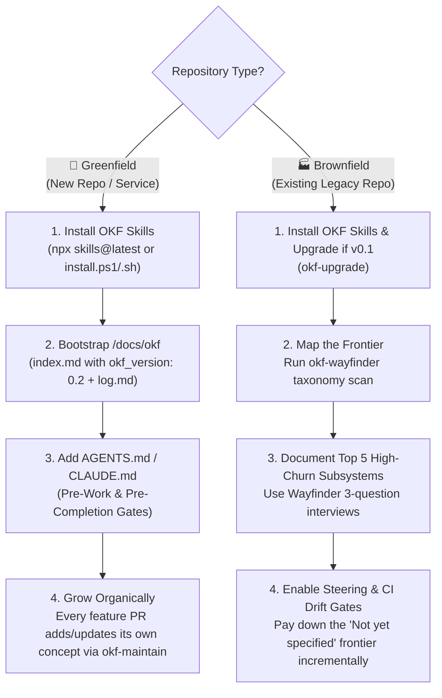

# Module 7: Capstone — Bootstrapping a Self-Documenting Repository End-to-End

**Level:** 🟣 Architect | **Estimated Time:** 30 minutes  
**Previous:** [← Module 6: Knowledge Hygiene & CI Gates](./06-pruning-hygiene-and-ci-gates.md) | **Back to Syllabus:** [Course Home](./README.md)

---

## 1. The Architect's Playbook: Greenfield vs. Brownfield Rollout

Congratulations on reaching the final module of the OKF Academy! You now understand the **Open Knowledge Format (OKF v0.2)** specification and all 8 skills in the **Closed-Loop Agentic Knowledge Pipeline**.

How you roll out OKF across a real engineering organization depends on whether you are starting a **Greenfield** project or onboarding a **Brownfield** (legacy) codebase:



### Strategy A: Greenfield Repositories (Zero-Debt from Day 1)
1. Initialize `/docs/okf/index.md` (`okf_version: 0.2`) and `/docs/okf/log.md`.
2. Commit `AGENTS.md` (and `CLAUDE.md` / `.cursorrules`) with the v1.6.0 **Pre-Work Grounding Gate** and **Pre-Completion Verification Gate**.
3. Author 2–3 foundational concepts (`Architecture`, `Domain Model`, `Development Workflow`).
4. Add `okf-lint --drift` to your CI workflow. Because the bundle grows alongside every PR from Commit #1, the repository **never** accumulates undocumented legacy debt.

### Strategy B: Brownfield Repositories (The "Touch-It, Map-It" Rule)
**Never** freeze feature development for two weeks to document 500 legacy files at once. Instead:
1. Run `okf-maintain` once to populate the `## Not yet specified` frontier in `index.md`.
2. Use `okf-wayfinder` to interview senior engineers on just the **top 3–5 highest-risk modules** (e.g., Auth, Billing, Core Database Schema, Deployment Pipeline).
3. Enforce the **"Touch-It, Map-It" rule** via `AGENTS.md`: whenever an agent or engineer modifies an undocumented file from `## Not yet specified`, they document that single concept as part of the PR. Within 6–8 sprints, the active 80% of your codebase is documented organically!

---

## 2. Team Governance: Designing Your OKF v0.2 Trust Policy

Not every concept in a repository requires the same level of ceremony. As an Architect, use **OKF v0.2 Trust Tiers** and `stale_after` to match governance to risk:

| Subsystem Tier | Examples | Recommended Trust Tier | Recommended `stale_after` Policy |
| :--- | :--- | :--- | :--- |
| **Tier 1: Mission-Critical & Regulated** | Auth/Security, Billing/ASC-606 (`Attested Computation`), Production DB Schemas | 🟢 **`human-reviewed`** (`verified` must include `human:<lead-id>`) | **90–180 days** (Forces quarterly/semi-annual human re-attestation) |
| **Tier 2: Core Services & Internal APIs** | Microservice routing, Queue retry policies, CI/CD workflows | 🔵 **`machine-confirmed`** (`verified` by `okf-lint` or independent reviewer agent) | **365 days** (Relies primarily on `okf-lint --drift` git tracking) |
| **Tier 3: Low-Risk Utilities & Drafts** | UI helpers, CLI scripts, experimental RFCs (`status: draft`) | ⚪ **`unverified`** (`generated` by coding agent during PR) | Optional / None |

---

## 3. Complete Command Reference Cheat Sheet

Keep this quick reference handy when working with any OKF v0.2 repository:

| Lifecycle Stage | Skill | Command |
| :--- | :--- | :--- |
| **Discover Frontier & Taxonomy** | `okf-wayfinder` | `node okf-wayfinder/scripts/wayfinder_taxonomy.js` |
| **Search Concepts by Keyword** | `okf-query` | `node okf-query/scripts/query.js --search "<keyword>"` |
| **Inject Context for a File** | `okf-query` | `node okf-query/scripts/query.js --file "<path/to/file>"` |
| **Auto-Sync Timestamps, Frontier & Steering** | `okf-maintain` | `node okf-maintain/scripts/maintain.js` (`--check` for CI audit) |
| **Lint Conformance, Links & Git Drift** | `okf-lint` | `node okf-lint/scripts/lint.js --drift` (`--strict-links`, `--json`) |
| **Render Interactive Cytoscape Graph** | `okf-visualize` | `node okf-visualize/scripts/visualize.js --bundle docs/okf` |
| **Upgrade Legacy v0.1 Bundle to v0.2** | `okf-upgrade` | `node okf-upgrade/scripts/upgrade.js` |
| **Audit / Archive Expired & Ghost Concepts** | `okf-prune` | `node okf-prune/scripts/prune.js --dry-run` (omit `--dry-run` to archive) |

---

## 🏆 Capstone Hands-On Lab: Full-Lifecycle Verification Audit

In this final lab, you will execute a complete 4-stage architectural audit across both the practice sandbox (`docs/course/sandbox`) and the live `okf-skills` repository.

### Stage 1: Verify the Sandbox Frontier (`okf-wayfinder`)
```bash
node -e "const { execSync } = require('child_process'); const t = JSON.parse(execSync('node ../../../okf-wayfinder/scripts/wayfinder_taxonomy.js', { cwd: 'docs/course/sandbox' })); console.log('Undocumented frontier files:', t.frontier.map(f => f.path));"
```

### Stage 2: Query an `Attested Computation` & Verify `human-reviewed` Trust (`okf-query`)
```bash
node -e "const { execSync } = require('child_process'); console.log(execSync('node ../../../okf-query/scripts/query.js --search MRR', { cwd: 'docs/course/sandbox' }).toString());"
```

### Stage 3: Audit Expired Concepts Without Mutating Disk (`okf-prune --dry-run`)
```bash
node -e "const { spawnSync } = require('child_process'); console.log(spawnSync('node', ['../../../okf-prune/scripts/prune.js', '--dry-run'], { cwd: 'docs/course/sandbox', encoding: 'utf8' }).stdout);"
```

### Stage 4: Run the Production Repository Drift & Lifecycle Test Suite
```bash
npm run okf:lint:drift
npm test
```

---

## 🤖 Agent Tutor Prompt (Capstone Simulation)

Copy and paste this prompt into your AI coding agent to complete the interactive Capstone Challenge:

> ```text
> Act as my OKF Academy Capstone Examiner (Module 7). Present me with a realistic brownfield architecture scenario where a team has:
> 1) An undocumented tax calculation file (src/invoice-tax-engine.js),
> 2) A legacy v0.1 payment concept (legacy-payment-service.md),
> 3) An expired OAuth1 concept (expired-auth-flow.md), and
> 4) A CFO asking how to prevent AI agents from inventing inconsistent SQL queries for Net MRR.
> Ask me to prescribe the exact OKF v0.2 skill and metadata fields to solve each of the 4 problems, grade my response, and award my OKF Architect completion summary!
> ```

---

## ✅ Final Capstone Knowledge Check

**Question 1:** When rolling out OKF to a large brownfield repository with hundreds of existing files, what is the recommended onboarding strategy?
- A) Halt all product engineering for a month until 100% of files have concepts.
- B) Map the frontier in `index.md` (`## Not yet specified`), use `okf-wayfinder` to document the top 3–5 highest-risk subsystems first, and use the "Touch-It, Map-It" rule via `AGENTS.md` to document remaining files incrementally as they are edited. *(Correct)*
- C) Auto-generate 500 unverified concepts in a single batch without human interviews.

**Question 2:** A financial calculation concept (`Monthly Recurring Revenue`) must never be altered by an agent without Finance sign-off and must be re-verified every 6 months. Which combination of OKF v0.2 features enforces this?
- A) `type: Attested Computation`, a `verified` entry with `by: human:<finance-lead>`, and a `stale_after` timestamp set 6 months in the future. *(Correct)*
- B) Putting `DO NOT TOUCH` in the filename.
- C) Setting `status: draft`.

**Question 3:** Before an AI coding agent claims a coding task is complete in an OKF-enabled repository, what two commands must pass in the **Pre-Completion Verification Gate**?
- A) `git init` and `npm init`
- B) `node okf-maintain/scripts/maintain.js` and `node okf-lint/scripts/lint.js --drift` (with 0 errors and 0 warnings) *(Correct)*
- C) `okf-prune --delete` and `git push --force`
