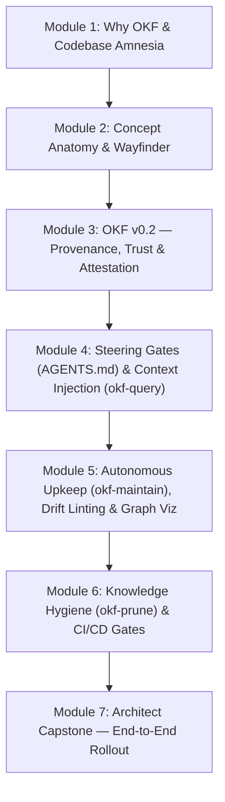

# 🎓 The OKF Academy: Mastering Self-Documenting Codebases (OKF v0.2)

> **Interactive Web Course:** Open [`course.html`](../../course.html) in your browser (or visit [`https://eloybar.github.io/okf-skills/course.html`](https://eloybar.github.io/okf-skills/course.html)) for the interactive edition featuring the **OKF v0.1 vs. v0.2 Diff Explorer**, **Trust Tier State Machine Simulator**, **One-Click CLI Labs**, and **Progress Tracker**.

Welcome to the complete curriculum for the **Open Knowledge Format (OKF)** and the **Closed-Loop Agentic Knowledge Pipeline**. This course takes you progressively from **Beginner** (understanding why documentation rots and how OKF fixes it) to **Architect** (enforcing v0.2 provenance, trust tiers, attested computations, and autonomous upkeep gates across teams and CI pipelines).

---

## 🗺️ Course Architecture & The 10-Step Knowledge Loop

Every module in this course maps directly to a concrete stage of the closed-loop OKF lifecycle:

---

## 📚 Complete Syllabus

| Module | Level | Est. Time | Core Skills & Topics Covered |
| :--- | :--- | :--- | :--- |
| **[Module 1: The Crisis of Codebase Amnesia & Why OKF Exists](./01-why-okf-and-codebase-amnesia.md)** | 🟢 Beginner | 15 min | The Cold-Start Tax, Token Economics, the 4 OKF Principles (*Readable, Parseable, Diffable, Portable*), `index.md` progressive disclosure, and `log.md`. |
| **[Module 2: Anatomy of an OKF Concept & Guided Onboarding](./02-concept-anatomy-and-wayfinder.md)** | 🟢 Beginner → 🟡 Intermediate | 20 min | Reserved vs. Concept files, YAML frontmatter, untyped dependency graphs (`/concepts/...`), flat-to-nested scaling (≥10 concepts), and `okf-wayfinder` frontier discovery. |
| **[Module 3: What Changed in OKF v0.2 & The Problems It Solves](./03-okf-v02-trust-provenance-and-attestation.md)** | 🟡 Intermediate *(Core Focus)* | 30 min | **The 4 Pillars of OKF v0.2:** 1) Structured `sources` & `[^id]` footnotes, 2) Actor identity (`generated`/`verified`) & Trust Tiers (`unverified`, `machine-confirmed`, `human-reviewed`), 3) Lifecycle & `stale_after`, 4) `Attested Computation`, plus `okf-upgrade`. |
| **[Module 4: Closing the Loop — Steering Gates & Context Injection](./04-steering-gates-and-context-injection.md)** | 🟡 Intermediate | 20 min | Why docs fail without agent enforcement; `AGENTS.md` / `CLAUDE.md` v1.6.0 Pre-Work Grounding Gates, Grounding Citations, and `okf-query` (`--search`, `--file`). |
| **[Module 5: Autonomous Upkeep, Drift Detection & Visualization](./05-autonomous-upkeep-drift-and-visualization.md)** | 🔵 Advanced | 25 min | Pre-Completion Verification Gates, `okf-maintain` auto-sync & frontier tracking, `okf-lint --drift` git timestamp comparisons, and `okf-visualize` Cytoscape.js graph audits. |
| **[Module 6: Knowledge Hygiene at Scale — Pruning & CI Gates](./06-pruning-hygiene-and-ci-gates.md)** | 🔵 Advanced → 🟣 Architect | 20 min | The 4 classes of decay (*Expired, Deprecated, Ghost, Orphaned*), `okf-prune` safe archiving vs. deletion, and GitHub Actions CI enforcement. |
| **[Module 7: Capstone — Bootstrapping a Self-Documenting Repo](./07-capstone-self-documenting-repo.md)** | 🟣 Architect | 30 min | Brownfield vs. Greenfield rollout playbooks, team governance for `human-reviewed` tiers, and the end-to-end Capstone Challenge. |

---

## 🧪 Hands-On Sandbox Environment (`docs/course/sandbox/`)

To let you practice every CLI command safely without modifying the main repository's production knowledge bundle (`/docs/okf`), this course includes a dedicated, isolated miniature workspace at [`docs/course/sandbox/`](./sandbox/):

* [`sandbox/okf/index.md`](./sandbox/okf/index.md) — Root catalog index for the practice bundle.
* [`sandbox/okf/concepts/legacy-payment-service.md`](./sandbox/okf/concepts/legacy-payment-service.md) — Intentional **OKF v0.1** legacy concept (using `timestamp` and inline `# Citations`) to practice `okf-upgrade`.
* [`sandbox/okf/concepts/expired-auth-flow.md`](./sandbox/okf/concepts/expired-auth-flow.md) — Concept with an expired `stale_after` timestamp (`2025-01-01T00:00:00Z`) to practice `okf-prune --dry-run`.
* [`sandbox/okf/concepts/revenue-mrr-metric.md`](./sandbox/okf/concepts/revenue-mrr-metric.md) — Complete **OKF v0.2 `Attested Computation`** with a `human-reviewed` trust tier and `[^id]` provenance footnotes.
* [`sandbox/src/payments.js`](./sandbox/src/payments.js) & [`sandbox/src/invoice-tax-engine.js`](./sandbox/src/invoice-tax-engine.js) — Sample source files for testing `okf-query --file` and `okf-wayfinder` frontier detection.

---

## 🚀 Ready to Begin?

👉 **[Start Module 1: The Crisis of Codebase Amnesia & Why OKF Exists →](./01-why-okf-and-codebase-amnesia.md)**
